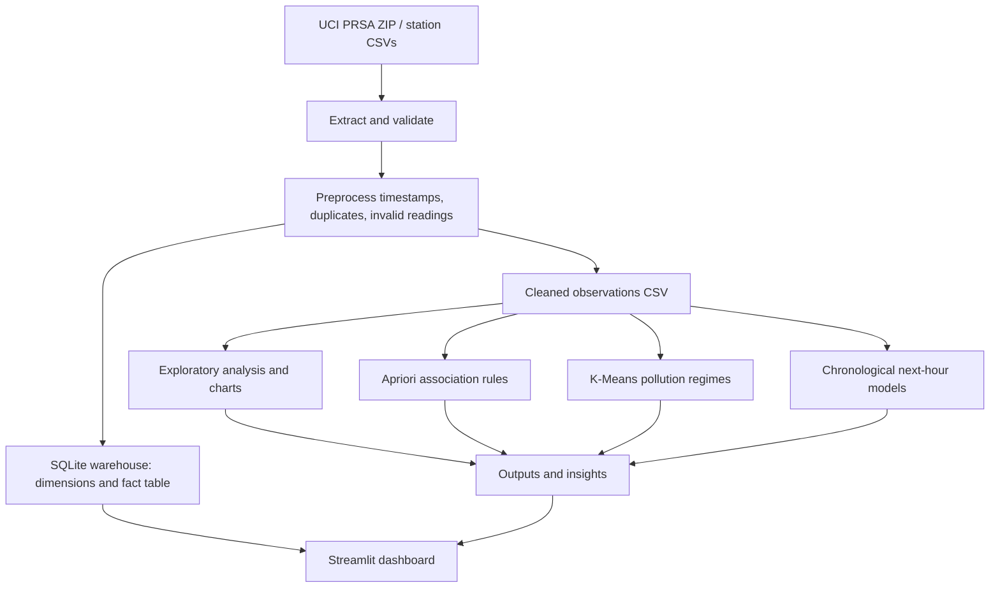

# AirLens architecture

The numerical imputer and categorical encoder for predictive models are fitted within model pipelines, using training rows only. The model train/test split is ordered by target timestamp.
